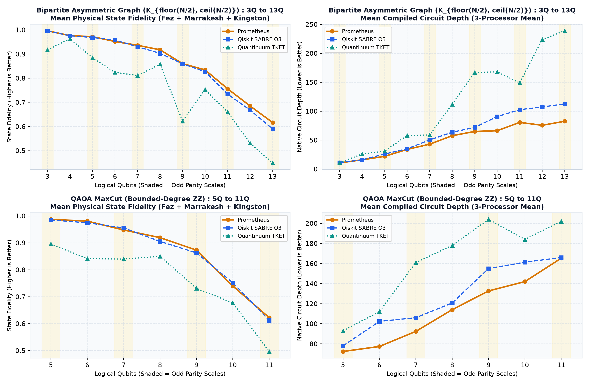
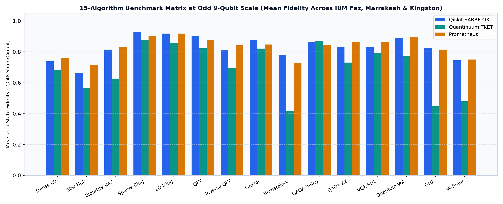

# IBM Heron r2 (156Q) Compiler Benchmarks: Odd/Even Scaling, 15-Algorithm Matrix & Pre-Committed Validation Suite

Controlled 3-way hardware compilation benchmarks comparing **Prometheus**, **Qiskit SABRE O3**, and **Quantinuum TKET** across three physical 156-qubit IBM Heron r2 quantum processors (`ibm_fez`, `ibm_marrakesh`, and `ibm_kingston`).

All **10 packed `SamplerV2` batch jobs (`441` physical circuit executions, `755,712` hardware shots)** place all three compilers inside the same hardware batch window so each 3-way comparison executes under identical calibration conditions.

---

## Executive Summary & Principal Findings

### Experiments 1 & 2: 3-Way Distribution Fidelity & TVD Benchmarks (`99` Tournaments / `297` Circuits)

| Campaign / Benchmark Subset | Hardware Jobs (Circuits / Shots) | Prometheus Depth <= SABRE (↓) | Prometheus Fidelity >= SABRE (↑) | Prometheus Fidelity >= TKET (↑) | Mean Fidelity $F_B$ (`SABRE / TKET / Prom` ↑) | Mean TVD (`SABRE / TKET / Prom` ↓) |
| :--- | :---: | :---: | :---: | :---: | :---: | :---: |
| **Exp 1: Odd/Even Scale Sweep (`3Q`-`13Q`)** | 3 jobs (`162` circs / `331,776` shots) | **54 / 54 (100.0%)** | **38 / 54 (70.4%)** | **49 / 54 (90.7%)** | 0.8588 / 0.7559 / **0.8652** | 0.2148 / 0.3361 / **0.2058** |
| **Exp 1: Odd Scales (`3,5,7,9,11,13Q`)** | 3 jobs (`90` circs / `184,320` shots) | **30 / 30 (100.0%)** | **22 / 30 (73.3%)** | **27 / 30 (90.0%)** | 0.8494 / 0.7307 / **0.8568** | 0.2164 / 0.3544 / **0.2079** |
| **Exp 1: Even Scales (`4,6,8,10,12Q`)** | 3 jobs (`72` circs / `147,456` shots) | **24 / 24 (100.0%)** | **16 / 24 (66.7%)** | **22 / 24 (91.7%)** | 0.8705 / 0.7873 / **0.8756** | 0.2129 / 0.3133 / **0.2032** |
| **Exp 2: 15-Algorithm Matrix (`9Q` Odd)** | 3 jobs (`135` circs / `276,480` shots) | 30 / 45 (66.7%) | **27 / 45 (60.0%)** | **40 / 45 (88.9%)** | 0.8278 / 0.6969 / **0.8304** | 0.2524 / 0.3880 / **0.2504** |
| **Combined Exp 1 + 2 (`99` Tournaments)** | **6 jobs (`297` circs / `608,256` shots)** | **84 / 99 (84.8%)** | **65 / 99 (65.7%)** | **89 / 99 (89.9%)** | 0.8447 / 0.7291 / **0.8494** | 0.2319 / 0.3597 / **0.2261** |

### Experiment 3: Pre-Committed 144-Execution Multi-QPU Validation Suite ([`validation_suite_144_executions/`](validation_suite_144_executions/))

| Pre-Committed Suite Cohort | Hardware Jobs (Circuits / Shots) | Prometheus Depth <= SABRE (↓) | Primary Metric Wins vs. SABRE O3 | Primary Metric Wins vs. TKET | Pre-Committed Multi-QPU Dispatch vs. Fixed SABRE O3 |
| :--- | :---: | :---: | :---: | :---: | :---: |
| **All 18 Primary Instances (`6Q, 9Q, 12Q` on `ibm_marrakesh`)** | 2 jobs (`108` circs / `110,592` shots) | **14 / 18 (77.8%)** | **16 / 18 (88.9%)** | **15 / 18 (83.3%)** | N/A (Single-backend Slot A) |
| **12-Qubit Scale Cohort (`6` Workloads on `ibm_marrakesh`)** | 2 jobs (`36` circs / `36,864` shots) | **6 / 6 (100.0%)** | **6 / 6 (100.0%)** | **6 / 6 (100.0%)** | N/A (Single-backend Slot A) |
| **9-Qubit Multi-QPU Broadcast (`ibm_marrakesh`, `ibm_fez`, `ibm_kingston`)** | 3 jobs (`54` circs / `55,296` shots) | **4 / 6 (66.7%)** | **5 / 6 (83.3%)** *(Slot A)* | **4 / 6 (66.7%)** *(Slot A)* | **6 / 6 (100%)** vs `ibm_marrakesh` & `ibm_fez`; **5 / 6 (83.3%)** vs `ibm_kingston` |
| **Complete Pre-Committed Campaign (`Slots A + B + C`)** | **4 jobs (`144` circs / `147,456` shots)** | **14 / 18 (77.8%)** | **16 / 18 (88.9%)** | **15 / 18 (83.3%)** | **6 / 6** vs Fixed A/B (`5 / 6` vs Fixed C) |


*Figure 1: Odd vs. Even Integer Qubit Scale Sweep (`3Q` to `13Q` Bipartite $K_{n/2, n-n/2}$ and QAOA MaxCut Bounded-ZZ; $N = 54$ 3-way tournaments / `162` physical circuits, `2,048` shots/circuit = `331,776` shots across `ibm_fez`, `ibm_marrakesh`, and `ibm_kingston`; source: [`data/heron_156q_99tournaments_297circuits.csv`](data/heron_156q_99tournaments_297circuits.csv)).*


*Figure 2: 15-Algorithm Benchmark Matrix at Odd 9-Qubit Scale ($N = 45$ 3-way tournaments / `135` physical circuits, `2,048` shots/circuit = `276,480` shots across `ibm_fez`, `ibm_marrakesh`, and `ibm_kingston`; source: [`data/heron_156q_99tournaments_297circuits.csv`](data/heron_156q_99tournaments_297circuits.csv)).*

### Metric Definitions & Direction Conventions
- **Classical Distribution Fidelity ($F_B$, ↑ higher is better):** In Experiments 1 and 2 ([`data/heron_156q_99tournaments_297circuits.csv`](data/heron_156q_99tournaments_297circuits.csv)), `fidelity` records the **Bhattacharyya distribution overlap** $F_B(P_{\text{ideal}}, P_{\text{meas}}) = \sum_{x \in \{0,1\}^n} \sqrt{P_{\text{ideal}}(x)\, P_{\text{meas}}(x)}$ between the noiseless Z-basis bitstring probability distribution $P_{\text{ideal}}(x)$ and the measured hardware distribution $P_{\text{meas}}(x)$ after inverse physical-to-logical qubit mapping.
- **Squared Hellinger Fidelity ($F_H = F_B^2$, ↑ higher is better):** In Experiment 3 ([`validation_suite_144_executions/`](validation_suite_144_executions/)), `squared_hellinger_fidelity` records $F_H(P_{\text{ideal}}, P_{\text{meas}}) = \left(\sum_{x \in \{0,1\}^n} \sqrt{P_{\text{ideal}}(x)\, P_{\text{meas}}(x)}\right)^2 = F_B^2$. Both $F_B$ and $F_H$ measure computational-basis distribution preservation from shot counts and are distinct from $4^n$ quantum state tomography.
- **Total Variation Distance ($\text{TVD}$, ↓ lower is better):** $\frac{1}{2} \sum_x |P_{\text{ideal}}(x) - P_{\text{meas}}(x)|$.
- **Heavy-Output Probability ($\text{HOP}$, ↑ higher is better):** Total measured probability mass on bitstrings whose ideal probability exceeds the median of $P_{\text{ideal}}(x)$.
- **Bolding Convention:** Across all tables below, **bold** values indicate the winning (best) compiler in each metric column for that row.

### Key Findings
1. **Odd Qubit Parity Stress on Heavy-Hex (`3Q`-`13Q`):** Testing consecutive odd and even scales (`3Q` through `13Q`) exposes asymmetric boundary routing in `SABRE O3` and `TKET`. On odd scales (`3Q, 5Q, 7Q, 9Q, 11Q, 13Q`), Prometheus beat `SABRE O3` on Distribution Fidelity ($F_B$ ↑) in **73.3% (22/30)** of tournaments and beat `TKET` on TVD (↓) in **96.7% (29/30)** of tournaments.
2. **13-Qubit Odd Bipartite ($K_{6,7}$) Scaling:** At `13Q Odd`, Prometheus reduced native depth from `112-113` (`SABRE O3`) and `239` (`TKET`) down to `82-84` (`-27%` vs SABRE, `-65%` vs TKET) and reduced 2Q `CZ` gates from `102` (`SABRE`) and `230` (`TKET`) down to `83-84`. On `ibm_fez`, Distribution Fidelity $F_B$ increased from `0.5572` (SABRE) and `0.4011` (TKET) to **`0.6396`** (`+14.8%` vs SABRE, `+59.5%` vs TKET). On `ibm_kingston`, $F_B$ increased from `0.6410` (SABRE) and `0.5293` (TKET) to **`0.6858`**.
3. **Pre-Committed 144-Execution Multi-QPU Validation Suite (`validation_suite_144_executions/`):** Across 18 pre-committed benchmark instances (`6Q, 9Q, 12Q` across `dense`, `bipartite`, `star`, `ising`, `qaoa`, and `qft_phase`; `4` packed `SamplerV2` batch jobs / `147,456` shots), Prometheus outperformed `SABRE O3` on **88.9% (16/18)** of primary task metrics, outperformed `TKET` on **83.3% (15/18)**, and won **100% (6/6)** at the `12-qubit` scale, while pre-committed multi-QPU dispatch beat fixed-backend `SABRE O3` on **6/6 (100%)** vs. `ibm_marrakesh` and `ibm_fez` (`5/6` vs. `ibm_kingston`).

---

## Master Batch Job Ledger (All 10 Packed `SamplerV2` Jobs)

```bash
python scripts/verify_ledger.py
python validation_suite_144_executions/check_scoring.py
```

| Experiment | Processor | IBM Quantum Job ID | 3-Way Triplets | Physical Circuits | Shots / Circuit | Total Shots |
| :--- | :--- | :--- | :---: | :---: | :---: | :---: |
| Exp 1: Odd/Even Scale Sweep (3Q to 13Q) | `ibm_marrakesh` | `dbc9olfi0auc73dug6ig` | 18 | 54 | 2,048 | 110,592 |
| Exp 1: Odd/Even Scale Sweep (3Q to 13Q) | `ibm_kingston` | `dbc9plgc77vs7385qqm0` | 18 | 54 | 2,048 | 110,592 |
| Exp 1: Odd/Even Scale Sweep (3Q to 13Q) | `ibm_fez` | `dbc9vq7i0auc73dugmjg` | 18 | 54 | 2,048 | 110,592 |
| Exp 2: 15-Algorithm Matrix (Odd 9Q) | `ibm_marrakesh` | `dbcacds24mrc73cj776g` | 15 | 45 | 2,048 | 92,160 |
| Exp 2: 15-Algorithm Matrix (Odd 9Q) | `ibm_kingston` | `dbcameni0auc73dui3f0` | 15 | 45 | 2,048 | 92,160 |
| Exp 2: 15-Algorithm Matrix (Odd 9Q) | `ibm_fez` | `dbcasi9gv2cc73e9v40g` | 15 | 45 | 2,048 | 92,160 |
| Exp 3: Pre-Committed Suite (Slot A, Blk 1) | `ibm_marrakesh` | `dbghgkdrd2mc73cuo0jg` | 18 | 54 | 1,024 | 55,296 |
| Exp 3: Pre-Committed Suite (Slot A, Blk 2) | `ibm_marrakesh` | `dbghgroiudkc73e4gvig` | 18 | 54 | 1,024 | 55,296 |
| Exp 3: Pre-Committed Suite (Slot B, 9Q) | `ibm_fez` | `dbghh7ljm0ks73egl000` | 6 | 18 | 1,024 | 18,432 |
| Exp 3: Pre-Committed Suite (Slot C, 9Q) | `ibm_kingston` | `dbgjtecdgr2s73crlre0` | 6 | 18 | 1,024 | 18,432 |
| **Total** | **3 Heron r2 QPUs** | **10 Batch Jobs** | **147** | **441** | **1,024 - 2,048** | **755,712** |

---

## Experiment 1: Odd vs. Even Integer Scale Sweep (3Q to 13Q)

### IBM Kingston (`ibm_kingston`) - Job ID: `dbc9plgc77vs7385qqm0`

| Workload | Scale | Parity | Depth (`S / T / P` ↓) | 2Q Gates (`S / T / P` ↓) | Distribution Fidelity $F_B$ (`S / T / P` ↑) | TVD (`S / T / P` ↓) | HOP (`S / T / P` ↑) |
| :--- | :---: | :---: | :---: | :---: | :---: | :---: | :---: |
| Bipartite K_1,2 | 3Q | ODD | 11 / 11 / **10** | **2** / **2** / **2** | 0.9952 / 0.9957 / **0.9983** | 0.0337 / 0.0430 / **0.0308** | 0.9370 / 0.9448 / **0.9561** |
| Bipartite K_2,2 | 4Q | EVEN | **16** / 26 / **16** | **6** / 10 / **6** | 0.9765 / **0.9776** / 0.9724 | 0.0745 / **0.0727** / 0.0801 | **0.9258** / 0.9233 / 0.9160 |
| Bipartite K_2,3 | 5Q | ODD | 26 / 31 / **24** | 12 / 15 / **10** | **0.9870** / 0.9366 / 0.9839 | **0.0659** / 0.1939 / 0.0695 | **0.9678** / 0.9258 / 0.9624 |
| Bipartite K_3,3 | 6Q | EVEN | 35 / 58 / **34** | **17** / 27 / **17** | 0.9709 / **0.9819** / 0.9722 | 0.0976 / **0.0664** / 0.0851 | 0.9536 / **0.9653** / 0.9541 |
| Bipartite K_3,4 | 7Q | ODD | 49 / 59 / **42** | 30 / 36 / **23** | 0.9466 / 0.5920 / **0.9537** | **0.1176** / 0.5253 / 0.1241 | 0.9517 / 0.8418 / **0.9678** |
| Bipartite K_4,4 | 8Q | EVEN | 62 / 112 / **56** | 44 / 57 / **35** | **0.9420** / 0.8477 / 0.9371 | **0.1203** / 0.2689 / 0.1340 | **0.9624** / 0.9121 / 0.9556 |
| Bipartite K_4,5 | 9Q | ODD | 72 / 167 / **65** | 48 / 89 / **41** | 0.8967 / 0.8228 / **0.9008** | 0.1725 / 0.2554 / **0.1649** | **0.9419** / 0.8940 / 0.9390 |
| Bipartite K_5,5 | 10Q | EVEN | 94 / 168 / **67** | 69 / 133 / **50** | 0.8547 / 0.7605 / **0.8622** | **0.2120** / 0.3239 / 0.2128 | 0.9551 / 0.9238 / **0.9575** |
| Bipartite K_5,6 | 11Q | ODD | 104 / 149 / **73** | 78 / 144 / **65** | **0.8170** / 0.7418 / 0.8128 | **0.2295** / 0.3143 / 0.2426 | **0.9609** / 0.9321 / 0.9463 |
| Bipartite K_6,6 | 12Q | EVEN | 107 / 224 / **76** | 84 / 199 / **71** | 0.7233 / 0.6293 / **0.7491** | 0.3177 / 0.4218 / **0.3013** | 0.9258 / 0.9180 / **0.9487** |
| Bipartite K_6,7 | 13Q | ODD | 112 / 239 / **82** | 102 / 230 / **83** | 0.6410 / 0.5293 / **0.6858** | 0.3845 / 0.4877 / **0.3410** | 0.9175 / 0.8848 / **0.9365** |
| QAOA MaxCut Bounded-ZZ | 5Q | ODD | **78** / 93 / **78** | **23** / 26 / **23** | 0.9858 / 0.7899 / **0.9901** | 0.0770 / 0.3428 / **0.0641** | **0.7974** / 0.5547 / 0.7881 |
| QAOA MaxCut Bounded-ZZ | 6Q | EVEN | 102 / 112 / **82** | 31 / 43 / **26** | 0.9817 / 0.7370 / **0.9873** | 0.1103 / 0.4073 / **0.0851** | 0.8184 / 0.4956 / **0.8257** |
| QAOA MaxCut Bounded-ZZ | 7Q | ODD | 106 / 161 / **88** | **36** / 56 / 37 | 0.9688 / 0.8494 / **0.9771** | 0.1242 / 0.2947 / **0.0992** | 0.7998 / 0.6450 / **0.8252** |
| QAOA MaxCut Bounded-ZZ | 8Q | EVEN | 121 / 178 / **111** | **42** / 61 / 45 | 0.9330 / 0.8884 / **0.9353** | 0.1786 / 0.2367 / **0.1711** | **0.8062** / 0.7510 / 0.8032 |
| QAOA MaxCut Bounded-ZZ | 9Q | ODD | 155 / 204 / **133** | **56** / 80 / **56** | 0.8619 / 0.7903 / **0.8959** | 0.2622 / 0.3378 / **0.2202** | 0.7275 / 0.6523 / **0.7769** |
| QAOA MaxCut Bounded-ZZ | 10Q | EVEN | 161 / 184 / **142** | **53** / 55 / 55 | 0.7835 / 0.7931 / **0.7957** | 0.3065 / **0.3016** / 0.3030 | **0.8057** / 0.8027 / 0.7959 |
| QAOA MaxCut Bounded-ZZ | 11Q | ODD | **166** / 202 / **166** | **53** / **53** / **53** | 0.6215 / 0.4515 / **0.6259** | 0.4184 / 0.5641 / **0.4104** | 0.7446 / 0.6230 / **0.7812** |

### IBM Fez (`ibm_fez`) - Job ID: `dbc9vq7i0auc73dugmjg`

| Workload | Scale | Parity | Depth (`S / T / P` ↓) | 2Q Gates (`S / T / P` ↓) | Distribution Fidelity $F_B$ (`S / T / P` ↑) | TVD (`S / T / P` ↓) | HOP (`S / T / P` ↑) |
| :--- | :---: | :---: | :---: | :---: | :---: | :---: | :---: |
| Bipartite K_1,2 | 3Q | ODD | **11** / **11** / **11** | **2** / **2** / **2** | 0.9963 / **0.9979** / 0.9969 | **0.0234** / 0.0254 / 0.0254 | 0.9458 / 0.9443 / **0.9536** |
| Bipartite K_2,2 | 4Q | EVEN | **16** / 26 / **16** | **6** / 10 / **6** | **0.9807** / 0.9695 / 0.9791 | 0.0798 / 0.0980 / **0.0795** | **0.9390** / 0.9229 / 0.9355 |
| Bipartite K_2,3 | 5Q | ODD | 26 / 31 / **21** | 12 / 15 / **10** | 0.9556 / 0.7932 / **0.9650** | 0.1223 / 0.3387 / **0.0817** | 0.9224 / 0.8569 / **0.9360** |
| Bipartite K_3,3 | 6Q | EVEN | 35 / 58 / **33** | **17** / 27 / **17** | **0.9565** / 0.9192 / 0.9502 | **0.1362** / 0.1962 / 0.1390 | **0.9424** / 0.9067 / 0.9307 |
| Bipartite K_3,4 | 7Q | ODD | 53 / 59 / **43** | 30 / 36 / **23** | 0.9338 / 0.9245 / **0.9423** | 0.1460 / 0.1493 / **0.1357** | 0.9307 / 0.9263 / **0.9521** |
| Bipartite K_4,4 | 8Q | EVEN | 67 / 112 / **61** | 44 / 57 / **33** | 0.8747 / 0.8498 / **0.8997** | 0.2299 / 0.2567 / **0.1993** | 0.9155 / 0.9116 / **0.9336** |
| Bipartite K_4,5 | 9Q | ODD | 72 / 167 / **65** | 48 / 89 / **41** | **0.8513** / 0.3034 / 0.8285 | **0.2430** / 0.7267 / 0.2623 | **0.9121** / 0.7539 / 0.8853 |
| Bipartite K_5,5 | 10Q | EVEN | 89 / 168 / **68** | 69 / 133 / **50** | **0.8092** / 0.7309 / 0.8065 | 0.2914 / 0.3809 / **0.2762** | **0.9453** / 0.9170 / 0.9341 |
| Bipartite K_5,6 | 11Q | ODD | 104 / 149 / **79** | 78 / 144 / **62** | 0.7620 / 0.5704 / **0.7729** | 0.3003 / 0.4966 / **0.2893** | **0.9312** / 0.8540 / 0.9277 |
| Bipartite K_6,6 | 12Q | EVEN | 107 / 224 / **75** | 84 / 199 / **71** | 0.6668 / 0.3977 / **0.6909** | 0.3722 / 0.6423 / **0.3494** | 0.9121 / 0.8525 / **0.9170** |
| Bipartite K_6,7 | 13Q | ODD | 113 / 239 / **82** | 102 / 230 / **83** | 0.5572 / 0.4011 / **0.6396** | 0.4537 / 0.6120 / **0.3779** | 0.8672 / 0.8643 / **0.8872** |
| QAOA MaxCut Bounded-ZZ | 5Q | ODD | 78 / 93 / **67** | 23 / 26 / **20** | 0.9862 / **0.9908** / 0.9852 | 0.0866 / **0.0700** / 0.0888 | 0.7783 / **0.7925** / 0.7832 |
| QAOA MaxCut Bounded-ZZ | 6Q | EVEN | 103 / 112 / **75** | 31 / 43 / **28** | 0.9632 / 0.9550 / **0.9713** | 0.1549 / 0.1691 / **0.1253** | 0.7642 / 0.7495 / **0.8022** |
| QAOA MaxCut Bounded-ZZ | 7Q | ODD | 106 / 161 / **90** | **36** / 56 / 37 | 0.9377 / 0.9289 / **0.9436** | 0.1737 / 0.1909 / **0.1716** | **0.7729** / 0.7451 / 0.7651 |
| QAOA MaxCut Bounded-ZZ | 8Q | EVEN | 121 / 178 / **111** | **42** / 61 / 45 | 0.9016 / 0.8439 / **0.9302** | 0.2223 / 0.3019 / **0.1812** | 0.7617 / 0.6904 / **0.7891** |
| QAOA MaxCut Bounded-ZZ | 9Q | ODD | 155 / 204 / **133** | **56** / 80 / **56** | 0.8547 / 0.7594 / **0.8754** | 0.2746 / 0.3747 / **0.2404** | 0.6958 / 0.5879 / **0.7417** |
| QAOA MaxCut Bounded-ZZ | 10Q | EVEN | 163 / 184 / **142** | **53** / 55 / 55 | **0.7552** / 0.5681 / 0.7344 | **0.3298** / 0.5109 / 0.3629 | 0.7559 / 0.6099 / **0.7656** |
| QAOA MaxCut Bounded-ZZ | 11Q | ODD | **165** / 202 / **165** | **53** / **53** / **53** | 0.6160 / 0.4323 / **0.6320** | 0.4194 / 0.5698 / **0.4163** | **0.7544** / 0.5610 / 0.7490 |

### IBM Marrakesh (`ibm_marrakesh`) - Job ID: `dbc9olfi0auc73dug6ig`

| Workload | Scale | Parity | Depth (`S / T / P` ↓) | 2Q Gates (`S / T / P` ↓) | Distribution Fidelity $F_B$ (`S / T / P` ↑) | TVD (`S / T / P` ↓) | HOP (`S / T / P` ↑) |
| :--- | :---: | :---: | :---: | :---: | :---: | :---: | :---: |
| Bipartite K_1,2 | 3Q | ODD | **11** / **11** / **11** | **2** / **2** / **2** | **0.9950** / 0.7569 / 0.9939 | **0.0338** / 0.4129 / 0.0381 | **0.9395** / 0.6777 / 0.9355 |
| Bipartite K_2,2 | 4Q | EVEN | **16** / 26 / **16** | **6** / 10 / **6** | 0.9704 / 0.9436 / **0.9771** | 0.0964 / 0.1481 / **0.0755** | 0.9048 / 0.8936 / **0.9253** |
| Bipartite K_2,3 | 5Q | ODD | 26 / 31 / **21** | 12 / 15 / **10** | 0.9629 / 0.9228 / **0.9670** | 0.0986 / 0.2055 / **0.0847** | 0.9385 / 0.9097 / **0.9390** |
| Bipartite K_3,3 | 6Q | EVEN | **35** / 58 / **35** | **17** / 27 / **17** | **0.9462** / 0.5716 / 0.9336 | **0.1233** / 0.5461 / 0.1402 | **0.9189** / 0.7046 / 0.9097 |
| Bipartite K_3,4 | 7Q | ODD | 49 / 59 / **44** | 30 / 36 / **23** | 0.9103 / **0.9166** / 0.9129 | 0.1770 / 0.1740 / **0.1574** | 0.9150 / **0.9478** / 0.9072 |
| Bipartite K_4,4 | 8Q | EVEN | 62 / 112 / **56** | 44 / 57 / **35** | 0.8925 / 0.8768 / **0.9162** | 0.2006 / 0.2324 / **0.1624** | 0.9243 / 0.9380 / **0.9443** |
| Bipartite K_4,5 | 9Q | ODD | 72 / 167 / **65** | 48 / 89 / **41** | 0.8314 / 0.7406 / **0.8517** | 0.2554 / 0.3676 / **0.2436** | 0.8921 / 0.8301 / **0.9194** |
| Bipartite K_5,5 | 10Q | EVEN | 89 / 168 / **64** | 69 / 133 / **51** | 0.8174 / 0.7680 / **0.8341** | 0.2702 / 0.3479 / **0.2483** | 0.9277 / 0.9268 / **0.9536** |
| Bipartite K_5,6 | 11Q | ODD | 100 / 149 / **90** | 78 / 144 / **67** | 0.6231 / 0.6672 / **0.6833** | 0.4296 / 0.4187 / **0.3702** | 0.8691 / 0.8882 / **0.8999** |
| Bipartite K_6,6 | 12Q | EVEN | 108 / 224 / **76** | 84 / 199 / **71** | 0.6138 / 0.5665 / **0.6146** | 0.4515 / 0.4839 / **0.4398** | 0.9019 / **0.9136** / 0.8979 |
| Bipartite K_6,7 | 13Q | ODD | 113 / 239 / **84** | 102 / 230 / **84** | **0.5718** / 0.4172 / 0.5238 | **0.4606** / 0.5984 / 0.4964 | **0.8770** / 0.8110 / 0.8604 |
| QAOA MaxCut Bounded-ZZ | 5Q | ODD | 78 / 93 / **72** | 23 / 26 / **22** | 0.9832 / 0.9074 / **0.9864** | **0.0879** / 0.2430 / **0.0879** | **0.7764** / 0.6514 / 0.7715 |
| QAOA MaxCut Bounded-ZZ | 6Q | EVEN | 102 / 112 / **75** | 31 / 43 / **28** | 0.9786 / 0.8313 / **0.9834** | 0.1088 / 0.3534 / **0.0929** | 0.7944 / 0.6235 / **0.8179** |
| QAOA MaxCut Bounded-ZZ | 7Q | ODD | 106 / 161 / **99** | **36** / 56 / 40 | **0.9597** / 0.7415 / 0.9229 | **0.1272** / 0.3989 / 0.1878 | **0.7896** / 0.5923 / 0.7339 |
| QAOA MaxCut Bounded-ZZ | 8Q | EVEN | **120** / 178 / **120** | **42** / 61 / **42** | 0.8812 / 0.8176 / **0.8927** | 0.2417 / 0.3267 / **0.2330** | **0.7583** / 0.6616 / 0.7539 |
| QAOA MaxCut Bounded-ZZ | 9Q | ODD | 155 / 204 / **132** | 56 / 80 / **52** | **0.8721** / 0.6432 / 0.8481 | **0.2506** / 0.4611 / 0.2854 | **0.7246** / 0.5425 / 0.6841 |
| QAOA MaxCut Bounded-ZZ | 10Q | EVEN | 160 / 184 / **142** | **53** / 55 / 55 | **0.7173** / 0.6707 / 0.6895 | **0.3826** / 0.4262 / 0.3984 | **0.7007** / 0.6450 / 0.6919 |
| QAOA MaxCut Bounded-ZZ | 11Q | ODD | 167 / 202 / **165** | **53** / **53** / **53** | 0.5995 / 0.6063 / **0.6092** | 0.4429 / 0.4382 / **0.4291** | 0.7061 / 0.7017 / **0.7354** |

## Experiment 2: 15-Algorithm Benchmark Matrix at Odd 9-Qubit Scale

### IBM Kingston (`ibm_kingston`) - Job ID: `dbcameni0auc73dui3f0`

| Algorithm Family (9Q Odd) | Depth (`S / T / P` ↓) | 2Q Gates (`S / T / P` ↓) | Distribution Fidelity $F_B$ (`S / T / P` ↑) | TVD (`S / T / P` ↓) | HOP (`S / T / P` ↑) |
| :--- | :---: | :---: | :---: | :---: | :---: |
| Dense All-to-All (K_9) | 138 / 165 / **109** | 82 / 123 / **74** | 0.7984 / 0.7710 / **0.8375** | 0.2683 / 0.3196 / **0.2190** | 0.8379 / 0.8311 / **0.8779** |
| Star Graph (Hub Stress) | **75** / 99 / 77 | 30 / 31 / **21** | 0.6840 / 0.7384 / **0.7693** | 0.3047 / 0.2612 / **0.2261** | 0.6953 / 0.7388 / **0.7739** |
| Bipartite Asymmetric (K_4,5) | 72 / 167 / **63** | 48 / 89 / **43** | 0.8862 / 0.8415 / **0.8982** | 0.1977 / 0.2377 / **0.1685** | 0.9380 / 0.9053 / **0.9453** |
| Sparse Periodic Odd Ring | **86** / 102 / 95 | **27** / 33 / 37 | **0.9430** / 0.9370 / 0.8719 | **0.1395** / 0.1512 / 0.2397 | 0.9863 / **0.9922** / 0.9766 |
| 2D Lattice Ising Trotter | **76** / 119 / 91 | **41** / 51 / 42 | **0.9391** / 0.9108 / 0.9333 | **0.1293** / 0.1871 / 0.1627 | **0.9858** / 0.9707 / 0.9819 |
| Quantum Fourier Transform | **176** / 324 / 234 | 87 / 106 / **82** | **0.9093** / 0.8417 / 0.9062 | **0.2134** / 0.2793 / 0.2148 | 0.5107 / **0.5122** / 0.4878 |
| Inverse QFT | 207 / 266 / **181** | 85 / 142 / **82** | **0.9107** / 0.8565 / 0.8632 | **0.1968** / 0.2594 / 0.2540 | **0.9229** / 0.8564 / 0.9028 |
| Grover Diffusion & Oracle | **165** / 244 / **165** | **52** / 83 / **52** | **0.9072** / 0.8575 / 0.8392 | **0.2182** / 0.2803 / 0.2870 | **0.6260** / 0.5435 / 0.5884 |
| Bernstein-Vazirani Oracle | 36 / 67 / **32** | 15 / 23 / **13** | 0.8199 / 0.6977 / **0.8490** | 0.1797 / 0.3022 / **0.1509** | 0.9883 / 0.9707 / **0.9927** |
| QAOA MaxCut (3-Regular) | **158** / 187 / 184 | **47** / 51 / 49 | **0.9022** / 0.8575 / 0.8151 | **0.1948** / 0.2638 / 0.3134 | **0.8809** / 0.8037 / 0.8423 |
| QAOA MaxCut (Bounded-ZZ) | 155 / 204 / **132** | 56 / 80 / **52** | 0.7964 / 0.7983 / **0.8948** | 0.3360 / 0.3287 / **0.2182** | 0.6758 / 0.6489 / **0.7769** |
| VQE Hardware-Efficient (SU2) | **121** / 146 / 138 | 49 / **45** / 57 | 0.7845 / 0.8694 / **0.8892** | 0.3151 / 0.2492 / **0.2150** | 0.7495 / 0.8560 / **0.8833** |
| Quantum Volume (Odd Brickwall) | **44** / 52 / **44** | **32** / **32** / **32** | 0.8887 / 0.8932 / **0.9032** | 0.2037 / 0.2046 / **0.1819** | 0.9404 / 0.9326 / **0.9541** |
| GHZ Multipartite Cascade | **28** / 36 / **28** | **8** / **8** / **8** | **0.8837** / 0.6884 / 0.8667 | **0.1152** / 0.3105 / 0.1289 | **0.8848** / 0.6895 / 0.8711 |
| W-State Excitation Cascade | 52 / **47** / 52 | **16** / **16** / **16** | 0.8417 / 0.7375 / **0.8508** | 0.1832 / 0.2734 / **0.1775** | 0.8906 / 0.8296 / **0.8999** |

### IBM Fez (`ibm_fez`) - Job ID: `dbcasi9gv2cc73e9v40g`

| Algorithm Family (9Q Odd) | Depth (`S / T / P` ↓) | 2Q Gates (`S / T / P` ↓) | Distribution Fidelity $F_B$ (`S / T / P` ↑) | TVD (`S / T / P` ↓) | HOP (`S / T / P` ↑) |
| :--- | :---: | :---: | :---: | :---: | :---: |
| Dense All-to-All (K_9) | 138 / 165 / **109** | 82 / 123 / **74** | 0.7685 / 0.6652 / **0.8003** | 0.2945 / 0.4115 / **0.2744** | 0.8184 / 0.7397 / **0.8481** |
| Star Graph (Hub Stress) | 75 / 99 / **69** | **30** / 31 / **30** | **0.8060** / 0.3705 / 0.7410 | **0.1938** / 0.6284 / 0.2588 | **0.8062** / 0.3716 / 0.7412 |
| Bipartite Asymmetric (K_4,5) | 72 / 167 / **65** | 48 / 89 / **41** | 0.8237 / 0.3064 / **0.8522** | 0.2794 / 0.7192 / **0.2380** | 0.8838 / 0.7295 / **0.9170** |
| Sparse Periodic Odd Ring | **86** / 102 / 94 | **27** / 33 / 37 | **0.9405** / 0.8053 / 0.9201 | **0.1445** / 0.3454 / 0.1711 | **0.9917** / 0.9863 / 0.9800 |
| 2D Lattice Ising Trotter | **75** / 119 / **75** | **41** / 51 / **41** | 0.9244 / 0.7876 / **0.9258** | 0.1732 / 0.3923 / **0.1719** | **0.9824** / 0.9492 / 0.9819 |
| Quantum Fourier Transform | **176** / 324 / 247 | 87 / 106 / **86** | **0.9087** / 0.8953 / 0.8184 | **0.2070** / 0.2319 / 0.3052 | 0.5078 / **0.5249** / 0.5029 |
| Inverse QFT | 205 / 266 / **183** | 85 / 142 / **82** | 0.8046 / 0.7489 / **0.8453** | 0.3287 / 0.3887 / **0.2803** | 0.8535 / 0.7803 / **0.8643** |
| Grover Diffusion & Oracle | 163 / 244 / **162** | **52** / 83 / **52** | **0.8848** / 0.8193 / 0.8646 | **0.2514** / 0.3223 / 0.2793 | **0.5903** / 0.5044 / 0.5513 |
| Bernstein-Vazirani Oracle | 36 / 67 / **32** | 15 / 23 / **13** | 0.8128 / 0.0405 / **0.8186** | 0.1870 / 0.9595 / **0.1812** | **0.9805** / 0.9253 / 0.9741 |
| QAOA MaxCut (3-Regular) | **158** / 187 / 184 | **47** / 51 / 49 | **0.8849** / 0.8823 / 0.8292 | **0.2301** / **0.2301** / 0.2927 | **0.8687** / 0.8477 / 0.8369 |
| QAOA MaxCut (Bounded-ZZ) | 155 / 204 / **133** | **56** / 80 / **56** | 0.8348 / 0.7430 / **0.8776** | 0.3000 / 0.3874 / **0.2268** | 0.6738 / 0.5781 / **0.7427** |
| VQE Hardware-Efficient (SU2) | **123** / 146 / 130 | 49 / **45** / 59 | **0.8637** / 0.7020 / 0.8523 | **0.2478** / 0.4189 / 0.2780 | **0.8501** / 0.7612 / 0.8018 |
| Quantum Volume (Odd Brickwall) | **44** / 52 / **44** | **32** / **32** / **32** | 0.9105 / 0.8439 / **0.9147** | 0.1770 / 0.2909 / **0.1760** | 0.9351 / 0.9268 / **0.9526** |
| GHZ Multipartite Cascade | **28** / 36 / **28** | **8** / **8** / **8** | 0.8631 / 0.4941 / **0.8648** | 0.1367 / 0.5020 / **0.1333** | 0.8633 / 0.4980 / **0.8667** |
| W-State Excitation Cascade | 55 / **47** / 54 | **16** / **16** / **16** | 0.7823 / 0.5253 / **0.7952** | 0.2188 / 0.4746 / **0.2053** | 0.8418 / 0.7007 / **0.8477** |

### IBM Marrakesh (`ibm_marrakesh`) - Job ID: `dbcacds24mrc73cj776g`

| Algorithm Family (9Q Odd) | Depth (`S / T / P` ↓) | 2Q Gates (`S / T / P` ↓) | Distribution Fidelity $F_B$ (`S / T / P` ↑) | TVD (`S / T / P` ↓) | HOP (`S / T / P` ↑) |
| :--- | :---: | :---: | :---: | :---: | :---: |
| Dense All-to-All (K_9) | 138 / 165 / **118** | 82 / 123 / **76** | **0.6471** / 0.6096 / 0.6402 | **0.4496** / 0.4584 / 0.4619 | 0.7339 / 0.7495 / **0.7705** |
| Star Graph (Hub Stress) | **72** / 99 / 80 | 30 / 31 / **28** | 0.5044 / 0.5889 / **0.6359** | 0.4937 / 0.4077 / **0.3564** | 0.5063 / 0.5923 / **0.6436** |
| Bipartite Asymmetric (K_4,5) | 72 / 167 / **65** | 48 / 89 / **41** | 0.7349 / 0.7330 / **0.7452** | 0.3695 / 0.3920 / **0.3671** | 0.8340 / **0.8667** / 0.8340 |
| Sparse Periodic Odd Ring | **86** / 102 / 100 | **27** / 33 / 41 | 0.8980 / 0.8874 / **0.9105** | 0.2411 / 0.2624 / **0.1968** | **0.9932** / 0.9863 / 0.9844 |
| 2D Lattice Ising Trotter | 79 / 119 / **77** | 41 / 51 / **40** | 0.8904 / 0.8748 / **0.8968** | 0.2405 / 0.2702 / **0.2303** | **0.9790** / 0.9678 / 0.9736 |
| Quantum Fourier Transform | **177** / 324 / 238 | 87 / 106 / **85** | 0.8822 / 0.7307 / **0.9032** | 0.2471 / 0.3755 / **0.2207** | 0.4819 / **0.5156** / 0.4971 |
| Inverse QFT | 204 / 266 / **177** | 85 / 142 / **82** | 0.7191 / 0.4779 / **0.8183** | 0.4011 / 0.5991 / **0.2942** | 0.7725 / 0.5474 / **0.8516** |
| Grover Diffusion & Oracle | **163** / 244 / **163** | **52** / 83 / **52** | 0.8343 / 0.7858 / **0.8391** | **0.3048** / 0.3374 / 0.3082 | 0.4902 / **0.4927** / 0.4917 |
| Bernstein-Vazirani Oracle | **36** / 67 / 56 | **15** / 23 / 19 | **0.7141** / 0.5063 / 0.5107 | **0.2827** / 0.4937 / 0.4893 | **0.9902** / 0.9561 / 0.9038 |
| QAOA MaxCut (3-Regular) | **160** / 187 / 162 | **47** / 51 / 49 | 0.8124 / 0.8726 / **0.8920** | 0.3175 / 0.2499 / **0.2193** | 0.7705 / **0.8467** / 0.8159 |
| QAOA MaxCut (Bounded-ZZ) | 155 / 204 / **132** | 56 / 80 / **52** | **0.8634** / 0.6491 / 0.8259 | **0.2590** / 0.4659 / 0.3078 | **0.7104** / 0.5547 / 0.6504 |
| VQE Hardware-Efficient (SU2) | 123 / 146 / **92** | 49 / 45 / **36** | 0.8410 / 0.8060 / **0.8565** | 0.2897 / 0.3112 / **0.2777** | 0.8081 / 0.8247 / **0.8354** |
| Quantum Volume (Odd Brickwall) | **44** / 52 / **44** | **32** / **32** / **32** | 0.8662 / 0.5746 / **0.8674** | 0.2292 / 0.5688 / **0.2262** | 0.9268 / 0.8779 / **0.9360** |
| GHZ Multipartite Cascade | **28** / 36 / **28** | **8** / **8** / **8** | **0.7256** / 0.1601 / 0.7114 | **0.2744** / 0.8345 / 0.2886 | **0.7256** / 0.1655 / 0.7114 |
| W-State Excitation Cascade | 54 / **47** / 53 | **16** / **16** / **16** | **0.6096** / 0.1772 / 0.6052 | **0.3909** / 0.8224 / 0.3946 | **0.7568** / 0.5205 / 0.7515 |


---

## Experiment 3: Pre-Committed 144-Execution Multi-QPU Validation Suite (Oct 27, 2026)

Self-contained 144-execution pre-committed validation suite ([`validation_suite_144_executions/`](validation_suite_144_executions/)) evaluating **3-Way Hardware Performance (`SABRE O3` vs. `TKET` vs. `Prometheus`)** and **Multi-QPU Broadcast & Pre-Committed Dispatch** across `ibm_marrakesh`, `ibm_fez`, and `ibm_kingston` (`6Q`, `9Q`, `12Q` across `dense`, `bipartite`, `star`, `ising`, `qaoa`, and `qft_phase`, frozen prior to hardware execution in `commitments_hardware.json`).

## Scoreboard 1: 3-Way Hardware Performance (Primary Backend A `ibm_marrakesh`, 2 Blocks x 1,024 Shots)

*(Bolding indicates the best physical score in each row; `(↑)` = higher is better, `(↓)` = lower is better.)*

| Instance | Metric | SABRE O3 (2Q / d / Score) | TKET (2Q / d / Score) | Prometheus (2Q / d / Score) |
| :--- | :--- | :---: | :---: | :---: |
| `dense_6q_s260026` | `squared_hellinger_fidelity` (↑) | 79 / 159 / 0.8753 | 94 / 168 / 0.6971 | **71 / 141 / 0.8927** |
| `dense_9q_s260027` | `squared_hellinger_fidelity` (↑) | 210 / 300 / 0.6651 | 252 / 323 / 0.5352 | **155 / 203 / 0.7101** |
| `dense_12q_s260028` | `squared_hellinger_fidelity` (↑) | 339 / 374 / 0.2111 | 619 / 662 / 0.0844 | **307 / 325 / 0.2377** |
| `bipartite_6q_s260126` | `squared_hellinger_fidelity` (↑) | 48 / 109 / 0.8225 | 54 / 106 / 0.8095 | **46 / 89 / 0.8955** |
| `bipartite_9q_s260127` | `squared_hellinger_fidelity` (↑) | 141 / 222 / 0.7081 | 227 / 327 / 0.6759 | **116 / 156 / 0.7181** |
| `bipartite_12q_s260128` | `squared_hellinger_fidelity` (↑) | 142 / 128 / 0.2683 | 355 / 348 / 0.1913 | **142 / 128 / 0.3112** |
| `star_6q_s260226` | `squared_hellinger_fidelity` (↑) | 21 / 65 / 0.8754 | **22 / 63 / 0.9240** | 21 / 64 / 0.9038 |
| `star_9q_s260227` | `squared_hellinger_fidelity` (↑) | 48 / 152 / 0.7564 | **52 / 139 / 0.7846** | 48 / 111 / 0.6911 |
| `star_12q_s260228` | `squared_hellinger_fidelity` (↑) | 86 / 180 / 0.2692 | 82 / 182 / 0.3129 | **64 / 164 / 0.4031** |
| `ising_6q_s260326` | `absolute_magnetization_error` (↓) | **70 / 225 / 0.1325** | 90 / 291 / 0.2550 | 68 / 215 / 0.1405 |
| `ising_9q_s260327` | `absolute_magnetization_error` (↓) | 101 / 308 / 0.1829 | 90 / 343 / 0.2633 | **115 / 317 / 0.1338** |
| `ising_12q_s260328` | `absolute_magnetization_error` (↓) | 72 / 289 / 0.1989 | 72 / 362 / 0.3873 | **72 / 288 / 0.1208** |
| `qaoa_6q_s260426` | `mean_cut_over_exact_optimum` (↑) | 66 / 170 / 0.6304 | 72 / 175 / 0.5666 | **64 / 199 / 0.6590** |
| `qaoa_9q_s260427` | `mean_cut_over_exact_optimum` (↑) | 105 / 209 / 0.6271 | 139 / 218 / 0.6346 | **106 / 166 / 0.6446** |
| `qaoa_12q_s260428` | `mean_cut_over_exact_optimum` (↑) | 138 / 196 / 0.6624 | 198 / 270 / 0.6363 | **138 / 192 / 0.6765** |
| `qft_phase_6q_s260526` | `target_success_probability` (↑) | 58 / 136 / 0.3906 | 57 / 187 / 0.0605 | **46 / 115 / 0.4531** |
| `qft_phase_9q_s260527` | `target_success_probability` (↑) | 175 / 323 / 0.1392 | **171 / 250 / 0.2144** | 145 / 262 / 0.1450 |
| `qft_phase_12q_s260528` | `target_success_probability` (↑) | 312 / 439 / 0.0181 | 405 / 639 / 0.0005 | **219 / 351 / 0.0762** |

## Scoreboard 2: Multi-QPU Broadcast & Pre-Committed Dispatch (9Q Cohort, Block 1 Equal-Shot Comparison)

*(Fixed A = `ibm_marrakesh`, Fixed B = `ibm_fez`, Fixed C = `ibm_kingston`. Pre-committed `P-Dispatch` beat Fixed A `SABRE O3` on `6 / 6`, Fixed B `SABRE O3` on `6 / 6`, and Fixed C `SABRE O3` on `5 / 6` instances.)*

| Instance | Metric | Fixed A (SABRE / Prometheus) | Fixed B (SABRE / Prometheus) | Fixed C (SABRE / Prometheus) | Pre-Committed P-Dispatch |
| :--- | :--- | :---: | :---: | :---: | :---: |
| `dense_9q_s260027` | `squared_hellinger_fidelity` (↑) | 0.6721 / 0.6980 | 0.6586 / 0.7653 | 0.7506 / **0.7937** | **0.7937** (`C:ibm_kingston`) |
| `bipartite_9q_s260127` | `squared_hellinger_fidelity` (↑) | 0.6904 / 0.7147 | 0.7580 / 0.7657 | **0.8034** / 0.7918 | 0.7918 (`C:ibm_kingston`) |
| `star_9q_s260227` | `squared_hellinger_fidelity` (↑) | 0.7453 / 0.6769 | 0.8130 / 0.8201 | 0.8016 / **0.8276** | **0.8276** (`C:ibm_kingston`) |
| `ising_9q_s260327` | `absolute_magnetization_error` (↓) | 0.1874 / 0.1124 | 0.2512 / 0.1673 | 0.1553 / **0.0920** | **0.0920** (`C:ibm_kingston`) |
| `qaoa_9q_s260427` | `mean_cut_over_exact_optimum` (↑) | 0.6234 / 0.6388 | 0.6608 / **0.6742** | 0.6664 / 0.6667 | 0.6667 (`C:ibm_kingston`) |
| `qft_phase_9q_s260527` | `target_success_probability` (↑) | 0.1055 / 0.1231 | 0.2119 / 0.2871 | 0.3174 / **0.3486** | **0.3486** (`C:ibm_kingston`) |

---

## Prometheus Dynamics Public Repository Portfolio

| Repository | Scope & Empirical Dataset | Primary Verification Artifacts |
| :--- | :--- | :--- |
| **[`Hybrid-Quantum-HPC-Benchmarks`](https://github.com/PrometheusDynamicsCanada/Hybrid-Quantum-HPC-Benchmarks)** | **Multi-Cloud QPU & Hybrid GPU Corpus:** `12` live Amazon Braket `ProgramSet` tasks (`Rigetti Cepheus-1-108Q`, `IQM Garnet` 20Q, `IQM Emerald` 54Q), `107` IBM Heron 3-way jobs (`4Q`-`23Q`), `144`-execution pre-committed validation suite (`48.0s` QPU time), and `150` NVIDIA H100 (`VeloxQH100_1`) QUBO runs (`4` to `1,029` variables). | [`aws_braket_qpu_12_jobs_ledger.json`](https://github.com/PrometheusDynamicsCanada/Hybrid-Quantum-HPC-Benchmarks/blob/main/aws_braket_qpu_12_jobs_ledger.json), [`ibm_heron_156q_verified_benchmarks.json`](https://github.com/PrometheusDynamicsCanada/Hybrid-Quantum-HPC-Benchmarks/blob/main/ibm_heron_156q_verified_benchmarks.json), [`validation_suite_144_executions/`](https://github.com/PrometheusDynamicsCanada/Hybrid-Quantum-HPC-Benchmarks/tree/main/validation_suite_144_executions), `verify_corpus_and_schedules.py` |
| **[`IBM-Heron-156Q-Benchmarks`](https://github.com/PrometheusDynamicsCanada/IBM-Heron-156Q-Benchmarks)** | **156Q Heron r2 Scaling & Pre-Committed Suite:** `10` packed `SamplerV2` batch jobs (`441` physical circuits, `755,712` shots) across `ibm_fez`, `ibm_marrakesh`, and `ibm_kingston` covering `3Q`-`13Q` odd/even parity scaling, a `15-algorithm` matrix at `9Q`, and the `144-execution` pre-committed validation suite. | [`data/heron_156q_99tournaments_297circuits.csv`](https://github.com/PrometheusDynamicsCanada/IBM-Heron-156Q-Benchmarks/blob/main/data/heron_156q_99tournaments_297circuits.csv), [`validation_suite_144_executions/`](https://github.com/PrometheusDynamicsCanada/IBM-Heron-156Q-Benchmarks/tree/main/validation_suite_144_executions), `scripts/verify_ledger.py` |
| **[`qpu-selection-execution-quality`](https://github.com/PrometheusDynamicsCanada/qpu-selection-execution-quality)** | **Cryptographic Provenance & Cross-QPU Arbitration:** Archived IBM Quantum job ZIP bundles and `SHA-256` manifests (`16Q`-`23Q` dense all-to-all across `ibm_fez`, `ibm_kingston`, and `ibm_marrakesh`). | [`EVIDENCE_INDEX.md`](https://github.com/PrometheusDynamicsCanada/qpu-selection-execution-quality/blob/main/EVIDENCE_INDEX.md), [`REPOSITORY_SHA256SUMS.txt`](https://github.com/PrometheusDynamicsCanada/qpu-selection-execution-quality/blob/main/REPOSITORY_SHA256SUMS.txt), `Fez_Marrakesh_Kingston/3_verify_and_view.py` |
| **[`prometheus-quantum-telemetry`](https://github.com/PrometheusDynamicsCanada/prometheus-quantum-telemetry)** | **Mechanistic Operating Envelope (`01`-`05`):** Distributional concentration (`100k` shots/circuit), `40` randomized matched pairs, `3Q`-`10Q` scaling boundaries, `13Q` ground-state avoidance, and a `540`-PUB (`1.11M`-shot) 3-QPU sweep. | [`IBM_JOB_EVIDENCE_INDEX.csv`](https://github.com/PrometheusDynamicsCanada/prometheus-quantum-telemetry/blob/main/IBM_JOB_EVIDENCE_INDEX.csv), [`MASTER_RESULTS.csv`](https://github.com/PrometheusDynamicsCanada/prometheus-quantum-telemetry/blob/main/MASTER_RESULTS.csv), `verify_sha256_evidence.py` |
| **[`prometheus-execution-intelligence`](https://github.com/PrometheusDynamicsCanada/prometheus-execution-intelligence)** | **System Architecture & Execution-Selection Overview:** Multi-compiler candidate evaluation (`SABRE O3`, `TKET`, `Prometheus`), multi-QPU dispatch workflow, and Studio interface walkthrough. | [`ARCHITECTURE.md`](https://github.com/PrometheusDynamicsCanada/prometheus-execution-intelligence/blob/main/ARCHITECTURE.md), [`SCREENSHOT_GALLERY.md`](https://github.com/PrometheusDynamicsCanada/prometheus-execution-intelligence/blob/main/SCREENSHOT_GALLERY.md) |
| **[`Hyperion-fusion-telemetry`](https://github.com/PrometheusDynamicsCanada/Hyperion-fusion-telemetry)** | **Multi-Tokamak Disruption Forecasting Telemetry:** `4,121` supervised holdout discharges (`ASIPP EAST`, `GA DIII-D`, `MIT Alcator C-Mod`) with binary confusion matrices & 95% Wilson CIs, plus a `12,693`-shot `UKAEA MAST` archive audit (`2,017` disruptions). | [`data/holdout/cross_reactor_summary.csv`](https://github.com/PrometheusDynamicsCanada/Hyperion-fusion-telemetry/blob/main/data/holdout/cross_reactor_summary.csv), [`scripts/verify_classification_metrics.py`](https://github.com/PrometheusDynamicsCanada/Hyperion-fusion-telemetry/blob/main/scripts/verify_classification_metrics.py) |
